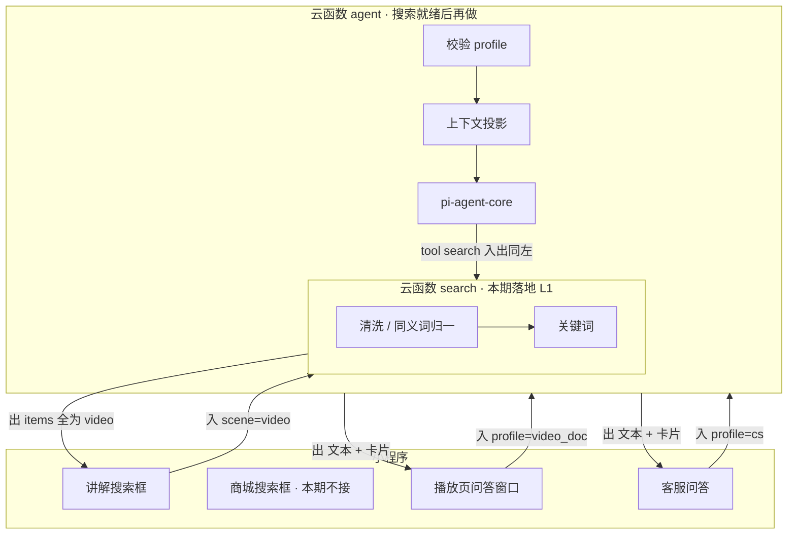
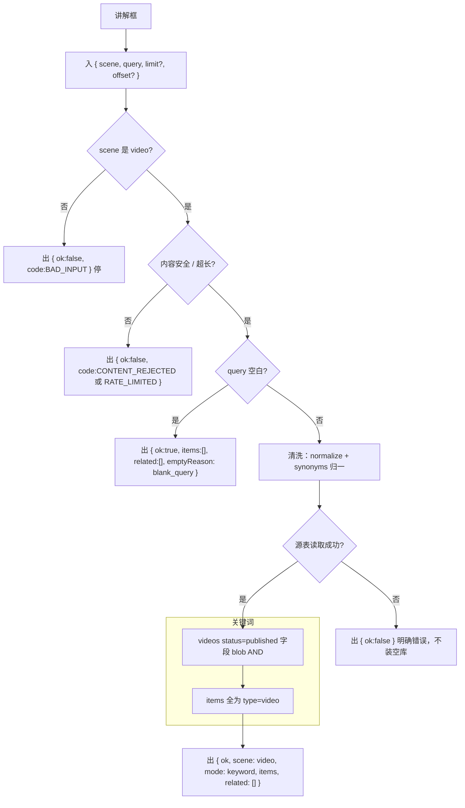

# 统一搜索（先）与 AI 问答（后）

状态：审查结论已并入（2026-09-14）。通过后再写业务代码。  
分支：`dev-ai-search`（从 `dev` 迁出）  
对照：总 spec / REQ-005～007；`docs/superpowers/plans/2026-09-09-04-unified-search.md`。

**落地顺序不变：** 先云函数 `search`，再 `agent`。  
**本期 `search` 范围（2026-09-14 再收窄）：** 只做**讲解视频**关键词检索。C 端只接讲解搜索框，`scene` 只接受 `video`；`items` 全是已上架视频。不接商城搜索框、不检索 `shop_products`、不填 `related`、不要求商品夹具。入参仍保留 `scene` 字段，其它取值（含 `product`）→ `BAD_INPUT`，给后续商城检索留同一契约。文本 RAG **不作为本期验收**。

## 图一：搜索+AI问答总图

两条进线（架构）：搜索框只进 `search`；问答进 `agent`，需要找片/找货时用 tool **`search`** 打回同一套 I/O。`search` 不跑 pi-agent-core。**本期只接通讲解框。**

本期实现讲解框 → L1；商城框与 `scene=product` 不在本分支。问答设计在本文定完，代码在下一分支。L2 见 §2.3。

### 图二：云函数 `search` 内部信息流（本期 = L1）

本期调用方：讲解框。日后同一入参形状再接商城框与 agent tool `search`。

本期 `mode` 恒为 `keyword`（仅 L1）。L2 就绪后的 `merged` / 嵌入失败降级见 §2.3。kb 块不进 `items`。不跑 pi-agent-core。

---

## 1. 为什么先搜索

AI 问答（播放页 + 客服）会调 tool。若没有统一 `search`，两套问答会各写一套检索，和「AI Native：底层一套、对人是接口、对 Agent 是 tool」相反。所以：**先把图中间的** `search` **落地（L1 契约即可接 tool），再接** `agent`**。不要把向量检索绑进「search 就绪」的定义。**

`catalog` 继续管品牌/视频入库。C 端搜索不再走 `catalog.search`。

相对计划 04：本期是讲解侧关键词检索迁到独立 `search`；计划 04 的「不做向量库」对本期仍然有效。商城 `scene=product` 从计划 04 本分支拆出，后续再做。L2 开工时再改总 spec / 计划 04 里向量库相关句。

---

## 2. 讲解搜索框：主信息流的输入 / 输出

条目形状（本期 `items` 的 `type` 均为 `video`；契约仍允许日后出现 `shop_product`）：

`{ type: 'video' | 'shop_product', id, title, coverFileId, summary, score? }`

### 2.1 搜索框 → `search`

讲解搜索框：**用户点搜索 → 小程序调云函数** `search` **（`scene: 'video'`）→ 用返回的** `items` **画列表**。不进 `agent`，没有模型对话。商城搜索框本期不改、不接入本函数。

|     |                                                                 |
| --- | --------------------------------------------------------------- |
| 入   | `{ scene: 'video', query, limit?, offset? }`                    |
| 出   | `{ ok, scene: 'video', mode: 'keyword', items[], related: [] }` |

`scene` 缺省、拼错或为 `product` → `{ ok: false, code: BAD_INPUT }`，不检索。本期 `related` 恒为空数组（不读 `video_shop_links`）。`mode: 'merged'` 留给 §2.3。

`query` 最长 500 字（与现网留言一致）；`limit`/`offset` 设上限。超限或触发配额 → 明确错误。搜索走与 `catalog` 留言相同的内容安全检查；失败 → `CONTENT_REJECTED`，不检索。

`items[]`：`{ type: 'video', id, title, coverFileId, summary, score? }`。点击进现有播放页。

#### 搜索框交互态（本期必须有）

| 状态 | 行为 |
| --- | --- |
| 提交后至返回前 | 列表区 loading；禁止重复提交 |
| 尚未提交 | 引导输入，不请求或沿用页内默认列表（与现网讲解搜索一致） |
| 空词提交 | `ok: true`，`items: []`，提示请输入关键词（与「搜不到」文案区分） |
| 有词零命中 | 提示未找到；可沿用现网换词提示。不要求引导去商城 tab |
| `ok: false` | 错误条 + 重试，保留 query；**不得**画成「暂无结果」 |
| 日后 `mode=keyword` 且本应跑 L2 | 列表上方非阻断提示「已用关键词结果」（本期无 L2，不展示此 banner） |

会话身份：云函数侧身份只使用 `cloud.getWXContext().OPENID`，忽略客户端传入的 openid。匿名用户用微信上下文给出的 OPENID。按 OPENID 做搜索/问答配额。

### 2.2 `search` 内部（本期：L1）

先清洗，再对 `videos` 做关键词检索。逻辑放在 `search` 云函数内（从现网 `catalogSearch.js` 复制或抽 lib，禁止 `search` require `catalog` 目录）。

**清洗：** `normalize`（去空白、小写）→ `synonyms` **归一**（别名替换为规范词后再按空格切分得到 `tokens[]`，与现网 `expandQuery` 相同；不是往 AND 条件里加同义词）。空 query：空 `items`，不报错。

#### 第一级：关键词（本期必做，已有雏形）

现网路径：`normalize` → `synonyms` 归一 → 字段 blob **AND** 匹配 → 标题/品牌型号加权。

只扫 C 端可见的已上架视频。字段：标题、简介、标签、`brandName`、`modelName`；已有则纳入 `searchAbstract` / `transcript*`（运营不强制转写才能上架）。**本期不读 `shop_products`。**

`tokens` 全部出现在 blob 中才命中。标题全匹配权重大于只中品牌/型号，再按 `publishedAt`。适合搜型号、标题里的原词。

**源表读失败（超时/抛错，不是 0 条）：** 整单 `{ ok: false }`，明确错误。禁止用空列表或「搜完了」装过去。（拍板 §5.3 选 A；本期无 L2，不存在「L2 有结果」分支。）

|     |                       |
| --- | --------------------- |
| 入   | `tokens[]` + 上架记录字段   |
| 出   | 命中视频条目（`type=video`，形状同 §2.1） |

本期不填 `related`（恒 `[]`）。用关联表挂商品是后续商城/播放页的事，不阻塞本分支。

#### 第二级：文本 RAG（下一阶段；先不做多模态）

**本轮不实现、不验收。** 下列为冻结设计，供 agent / L2 分支使用。

**入库（embedding 阶段）** 与 **查询（运行时）** 分开。

入库存什么（初期宁可窄）：

| 来源                  | chunk 内容                                 | 不存        |
| ------------------- | ---------------------------------------- | --------- |
| 已上架视频               | 标题、简介、标签、品牌/型号；有则加 `searchAbstract` / 转写 | 视频文件、帧、音频 |
| 已上架 `shop_products` | 名称、详情、规格、分类                              | 主图二进制     |
| 领域知识库               | 运营整理的说明文档切块                              | 整段教学视频    |

建议集合 `search_chunks`：

- `sourceType`: `video` | `shop_product` | `kb`
- `sourceId`: 源记录 `_id` 或知识条文 id
- `text`: chunk 正文
- `embedding`: 向量数组（一期语料小，数组即可）
- `published`: 仅作预过滤；**查询时必须回源** `videos` / `shop_products` 的上架状态，不符则丢弃
- `updatedAt`

L2 开工验收必须包含：上架/改文案/下架后该 `sourceId` 的 chunk 在约定时间内重建或删除；存量 published 一次性回填；一条不含原词的自然语言 query 能命中且 L1 单独无法解释。

**运行时：** 先按 `published` 预过滤 **且** `sourceType` 匹配当前 `scene` → 再对过滤后集合取 top-k（建议 k=8，指过滤后条数）→ 按 `sourceId` 聚合 → **回源上架状态** → 与 L1 相同条目形状。`kb` 块不进搜索框 `items`。

出参为 agent 预留 `passages[]`（含 `sourceType=kb` 的片段与 `sourceId`）：搜索框忽略该字段；问答投影与 tool **不得**绕过 `search` 直连 `search_chunks`。

**降级：** embedding 超时/失败 → 只用 L1，`mode: 'keyword'`。若此时 L1 为 0 条且 query 为未切出多 token 的中文长句 → **不得**用空列表冒充「已用关键词结果」；返回可理解错误或带 `degraded: ['rag']` 的明确「语义检索暂不可用」。基础设施失败 → `ok: false`，禁止装成空库。

**L1 与 L2：** L2 开工后默认两级都跑再合并（L1 稳短型号，L2 吃自然语言）。

**合并：** 同一 `type+id` 只留一条。一期 **不做 RRF**；L1 分与余弦分不可比，去重后按 L1 既有排序规则 + `limit` 截断，不以跨路「分更高」为公平序。

**规模闸门（L2 开工前写入实现计划）：** 内存余弦前提是一期 chunk 数小。实现计划须写清上限（建议 ≤500 条）、分页读轮数，以及越限后的迁移触发。未评估项：同生态 CloudBase PostgreSQL + pgvector 见文末待决。

### 2.3 RAG 选型（下一阶段拍板，非本期阻塞）

约束：微信云函数；语料初期为讲解元数据 + 少量领域文档。

**保密口径（审查后）：** 自管**向量库**；**不外发**视频/图片二进制。**会外发** `chunk.text` 与清洗后的 query 到第三方 Embeddings HTTP。禁止把 OPENID、会话历史、fileId、媒体二进制发给嵌入接口。密钥只放云函数环境变量：`EMBEDDING_API_KEY` / `EMBEDDING_BASE_URL` / `EMBEDDING_MODEL`。不把这些正文打进应用日志。

**推荐（L2 一期）：** 云函数内调用兼容 OpenAI embeddings 的接口，向量存在云数据库 `search_chunks`，运行时内存余弦。理由：语料小、无新基础设施、与现网「集合仅云函数可读写」一致。

**不推荐 L2 一期上：** 独立向量托管、多模态 RAG、把完整 mp4 上传给视频理解 API。

**Chunk：** 视频/商品一条源记录切 1 个 chunk（字段拼接，上限建议 2k 汉字，超出按段切开并带重叠 100 字）。知识库按标题/小节切，目标 400–800 汉字/块。

`search_chunks`、知识库、agent 消息表、`shop_products`、`video_shop_links` 均 **仅云函数可读写**（与 `videos` 相同）。C 端只调 `search` / `agent`，无运营票。重建 chunk 只允许运营/特权触发，C 端不可调。

具体模型见文末待决。入库与查询必须同一模型；换模型重建全部 chunks。

---

## 3 关于问答 Agent（本分支不实现；冻结接口）

**本分支（`dev-ai-search`）不实现本节代码。** 仅冻结 profile / tool / 投影，供下一分支引用。search 评审通过不依赖本节实现。

### 3.1 问答入口 → `agent`

小程序不跑循环，只把这一轮交给云函数。

| 来源     | 入 `agent`                                                                      | 出回页面                                |
| ------ | ------------------------------------------------------------------------------ | ----------------------------------- |
| 播放页窗口  | `{ profile: 'video_doc', message, videoId, currentTimeSec? }`，`videoId` 由当前页带上 | `{ text, cards[] }`，`cards` 可点视频/商品 |
| 客服 tab | `{ profile: 'cs', message }`                                                   | 同上；转人工后本轮可只有系统句，不再出 AI 气泡           |

`profile` 非法、或缺 `videoId`（仅 `video_doc`）→ `BAD_INPUT`，不调模型。

`video_doc` 必须先加载该 `videoId`：**仅 `status=published` 可继续**；否则 `NOT_FOUND`，不调模型、不跑 RAG、不注入草稿/下架文案。未登录可对**已上架当前片**提问；下单仍走商城。

### 3.2 `agent` 内部

| 环节            | 入                           | 出                                                          |
| ------------- | --------------------------- | ---------------------------------------------------------- |
| 校验            | 原始请求                        | 合法 profile + **wxContext OPENID** 会话键；否则直接错误                |
| 上下文投影         | profile、会话键、本轮 `message`、历史 | system + 本轮非对话材料 + 允许的 tools                               |
| pi-agent-core | 投影结果                        | 助手 `text` / `cards`；需要找片找货时调用 tool `search`（I/O = §2.1）     |

会话键：`video_doc` = `OPENID + videoId`；`cs` = `OPENID`。读写历史都按该键隔离。

`search` 未就绪时不要接 `agent`。

### 3.3 上下文中枢与 profile 一览

所有进 `agent` 的请求带 `profile`（不要和搜索框的 `scene=video|product` 混用）。中枢按 profile **投影** 成：system 片段 + 本轮附加材料 + 允许的 tools。不接文件 / shell 类 tool。播放页会话和客服会话不合并。

| profile                      | 入口                        | 会话键                | 注入材料                                         | tools                                                                 |
| ---------------------------- | ------------------------- | ------------------ | -------------------------------------------- | --------------------------------------------------------------------- |
| `video_doc`                  | 播放页：播放器 → 资料 → 关联商品 → 对话区 | `OPENID + videoId` | 当前片标题/简介/标签/品牌型号；可选 `currentTimeSec`；该片关联上架商品 | 当前视频文档字段（只读）；该片 `video_shop_links` 上的上架商品（只读）。无全库 `search`。无转人工。不把会话改成 `cs`。 |
| `cs`                         | 客服 tab 一条时间线              | `OPENID`           | 无强制「当前片」；可带最近一次 `search` 摘要                  | 日后 tool `search`。本期云函数只实现 `scene=video`；`scene=product` 待商城检索分支。转人工。查订单本设计不注册（计划 06）。 |
| （非 agent）`video`              | 讲解搜索框                       | 无会话                | 不经中枢                                         | 无                                                                     |

**拒绝请求：** `agent` 只接受 `video_doc` \| `cs`。缺省、拼错、或把搜索框用的 `video`/`product` 传来 → `{ ok: false, code: BAD_INPUT }`。

**客服转人工：** 入：常驻按钮。出：线程 `waiting_human` + 系统句「已转交」；之后用户消息只追加、不再进内核。不跳微信原生客服。运营回复与订阅属计划 06。无依据则说不知道；能引用则出可点卡片，不编造物流、不代替下单。

kb 摘要：仅在 L2/`passages` 就绪后注入；kb 若含内部运营材料，不得对未登录播放页默认全量公开——L2 分支须再定 kb 可见范围。

### 3.4 投影规则

- 只注入本 profile 需要的材料。客服上下文不要塞进某条视频的全部转写。播放页**不改 profile、不跳客服 tab、不注册转人工**。
- **与总 spec 一致，不改「请去打开 B」。** `video_doc` 只答当前 `videoId` 文档与该片关联上架商品。问到其它型号/其它视频：说明请回讲解搜索或打开对应播放页，可给搜索建议；**不**注入 B 的全文，**不**把播放页做成全站检索。跨片对比与找货放在 `cs`。
- 多轮：历史由 pi-agent-core / 消息表维护；中枢每轮重算非对话投影，不把简介只写在第一轮 system 里。消息表仅云函数可写；应用日志不记录原文 query/message/OPENID。
- 单轮 tool 建议 ≤5；超时返回可理解错误，会话可重试。

### 3.5 播放页抽帧（默认关）

一期：`currentTimeSec` 只当文案（「约第 N 秒」），默认不截帧。预留 `frameFileIds[]`。开关例如 `ENABLE_PLAYER_FRAMES=0`。

---

## 4. 本期验收 / 明确不做

**前置：** 现网已有 `videos` + `synonyms` 即可。不要求 `shop_products` 夹具。

**验收：**

- 讲解搜索走 `search` 且 `scene=video`；`items` 全为已上架视频；草稿/下架不出现。
- `scene` 非 `video`（含 `product`）→ `BAD_INPUT`。
- `related` 为空数组。
- 空词空列表，且文案与「有词零命中」可区分。
- 源表读失败 → `ok: false`，界面不是空库。
- **不**把框内 RAG / `mode=merged` / 商城检索当作本期 search 就绪。

**不做：** 商城搜索框接入、`scene=product`、`related` 填商品、商品夹具、播放页/客服对话 UI 与循环、转人工后台、支付与「我的」、搜索框闲聊、嵌入 HTTP、`search_chunks` 写入。

---

## 5. 已拍板（审查最佳判断）

1. **播放页就地答 B：不改总 spec。** `video_doc` 只答当前片 + 关联上架商品；其它型号请去搜索/打开 B。跨片走客服。
2. **嵌入模型：** 仍待选供应商（见文末）。L2 未开工前不阻塞 `search` L1。
3. **L1 读库故障：选 A。** 整单 `ok: false`。本期无「L2 有结果仍出列表」。
4. **RRF：选 A。** 一期不做。L2 开工后仍先按 L1 规则 + `limit`，不以跨路分数比大小。
5. **本期搜索只做视频。** 不接商城框、不检索可售商品、不填 `related`、不把商品夹具当本分支前置。`scene=product` 与关联推荐留给后续（仍用同一 `search` 契约加 `scene`）。

---

## 待决 / Open Questions

### From 2026-09-14 review

- L2 开工时嵌入供应商择一：百炼 `text-embedding-v3`、智谱 `embedding-3`，或国内可直连的 OpenAI 兼容网关上的 `text-embedding-3-small`（跨境直连 api.openai.com 不作为一期候选）。须确认知识库正文外发可接受。
- 是否用 CloudBase PostgreSQL + `pgvector` 替代「全量读入内存余弦」（同生态、有索引；与现有文档型集合权限模型不同）。
- kb 对未登录播放页是否全量可见，或按视频绑定。
- `search` / `agent` 的 OPENID 配额数值（QPS / 日上限）。
- 商城 `scene=product` 与 `related` 商品推荐何时接回同一 `search`（不在本分支）。
