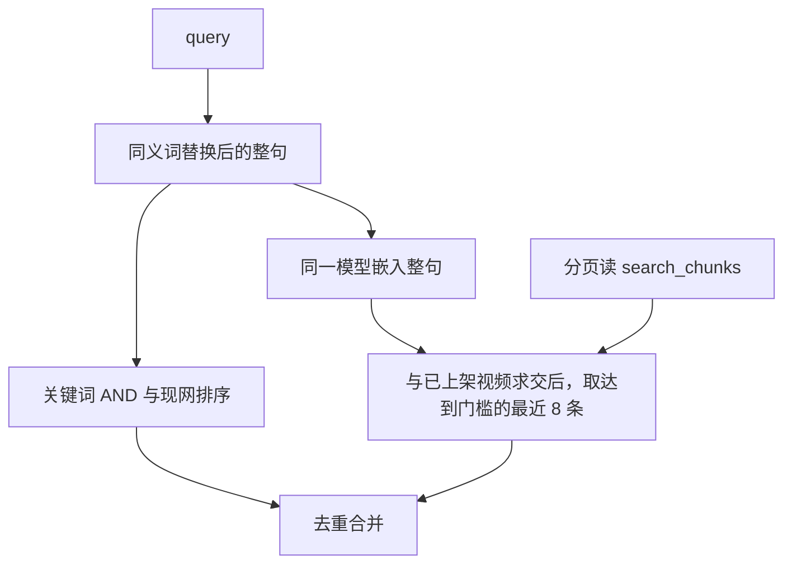

# 讲解搜索内部方案

状态：讨论稿，2026-10-22。给 Mentor 看拆分结果。还没替换 `2026-10-21-hybrid-video-search-design.md`。

对外契约在 `2026-10-22-hybrid-video-search-interface.md`。小程序只认那一份。这份写检索和建索引怎么做；改这里不用改已发布的小程序，只要搜索栏看到的 `items` 和 `notice` 仍符合接口稿。

实现分支仍是从最新 `dev` 迁出 `dev-vector-search`。不要写在 `dev-video-ingest-intro` 上，不要在 `main` 上直接改。

对照：

- `docs/superpowers/specs/2026-09-13-unified-search-context-hub-design.md` §2.2–§2.3、§3、§5
- 远程 `dev` 上已落地的 `cloudfunctions/search`（关键词）
- 2026-09-09 会议：搜索分三级；底层一套，对人是搜索框，对 Agent 是 tool

本分支不实现 pi-agent，不改播放页问答的产品边界。

开工闸门：云开发账号 `1479681315` 上 `kinfra-text-embedding-0.6b` 还有 100 万 tokens 免费额度。单条输入按 TokenHub 文本向量接口定为 2000 字符。余弦门槛已按已上架讲解的试算定为 0.678，写在 `search` 的配置里。后付费保持关闭。只领这一款向量模型。

---

## 1. 要做成什么样

讲解栏一次搜索里两路都跑：

1. **关键词路保持现网算法**，专门接型号、品牌、标题里的原词。
2. **向量路**接自然语言。用户没打出片里的原词时，仍能靠意思找到已上架讲解。

两路合成一个 `items` 列表。搜索框不生成答案，不进 pi-agent。

搜索栏只做查询。上架和改文案另走建索引。建索引不参与当次搜索排序。

---

## 2. 本期范围

做：

- 已上架讲解视频，一条视频一个文本块
- 块存在云数据库 `search_chunks`，带状态、内容哈希、失败原因和尝试次数；查询时内存余弦
- 向量路最多 8 条，且余弦必须达到上线前测出的门槛；只用与当前文案哈希一致的块
- 与关键词结果去重后，按接口稿返回 `items` 和可选的 `notice`
- 上架、改文案、下架、删除后重建或删除对应块；文案已变而重建未完成时，旧向量不再参与查询
- 存量回填和品牌改名走可续跑的索引任务

不做：

- 改关键词的切词、AND、加权
- 商品、知识库文档、`scene=product` 的真实检索
- 多模态、视频、封面、音频送去嵌入
- RRF，或把关键词名次和余弦分比大小
- pgvector、独立向量库
- 播放页 / 客服的对话循环、抽帧、转人工
- 搜索框闲聊

换嵌入模型就要整库重嵌。入库和查询用同一个模型名。库里模型名对不上的块，查询时跳过。

---

## 3. 关键词路

权威实现是远程 `dev` 的 `cloudfunctions/search/lib/keywordSearch.js`（与 `catalog/lib/catalogSearch.js` 同算法）。`search` 禁止 `require` `catalog` 目录。

现网行为不改：

- `normalize`：小写、空白收成一个空格、去首尾空白
- `synonyms`：别名按长度从长到短替换成规范词，再按空格切成 `tokens`
- 命中：每个 token 都是 `searchBlob` 的子串；`status` 必须是 `published`
- 排序：标题含整句或标题含全部 token 为 3 档；品牌或型号含任一 token 为 2 档；其余命中为 1 档；同档按 `publishedAt` 新的在前

`searchBlob` 仍由保存视频时写入，字段仍是标题、简介、`searchAbstract`、口播、分段转写、品牌、型号、标签、`entities`。向量块不替代 `searchBlob`。

关键词读 `videos` 失败（超时或抛错，不是 0 条）：整单 `ok: false`，`code` 为 `FAIL`。界面不能画成「没有找到」。

档位只在云函数内部排序，不放进 `items`。

---

## 4. 向量块

一条已上架视频对应 `search_chunks` 里的一条。正文按这个顺序拼接，空字段跳过：

1. 标题
2. 简介（库里的 `intro`，人工稿优先的那一版）
3. 标签
4. 品牌名
5. 型号
6. 转写：有 `transcript` 用它；否则用 `transcriptSegments` 的文本接起来

`searchAbstract` 和 `entities` 继续只进关键词的 `searchBlob`。视频文件、封面、音频、fileId、OPENID 不进块，也不发给嵌入接口。

块正文保留原文，不做关键词那套小写化。查询侧会做同义词替换，见 §6。

拼完是空串：不建块。草稿不上架：不建块。

转写可能很长。单条输入上限是 2000 字符，不是模型上下文的 32k tokens。只从转写尾部截断，标题到型号留全。截断后仍超限：不写 `embedding`，`status` 记为 `failed`，`error` 为 `input_too_long`。关键词路不受影响。本期不把一条视频切成多块。搜索块因此不能当作完整口播。

每条尝试过的已上架视频都留一行，包括失败、过期和跳过。同一 `sourceType + sourceId` 只有一行。

`contentHash` 是标题、简介、标签、品牌名、型号、转写按本节拼接规则算出的稳定哈希，用的是截断前的源字段。源文一变，哈希就变。保存视频时和 `searchBlob` 一起把这个哈希写在视频上。查询只比较视频上的这个短字符串和块上的哈希，不把转写再读出来重算。只接受 `status` 为 `ready` 且两个哈希一致的块。

文案变化时先把已有行标成 `stale`，再去嵌入。成功才写回 `ready` 和新的哈希、正文、向量。失败则标成 `failed`，不留下可用的旧向量。写入前再读一次视频；当前哈希和这次任务开始时的哈希不一致，就放弃这次写入，避免后完成的旧任务盖掉新版本。

| 字段 | 含义 |
| --- | --- |
| `sourceType` | 本期恒为 `video` |
| `sourceId` | `videos._id` |
| `status` | `ready`：向量对应当前文案。`stale`：文案已变，旧向量停用。`failed`：本该嵌入但没写成。`skipped`：正文为空，不嵌入 |
| `contentHash` | 这次准备嵌入的源字段哈希。`ready` 时必须等于视频上保存的哈希 |
| `error` | 短代码，不写正文。`ready` 时为空 |
| `attempts` | 实际发起嵌入的次数。已是 `ready` 且哈希、模型都没变时，再次遇到不加次数、也不再嵌入 |
| `text` | 仅 `ready` 时有，是实际拿去嵌入的正文（含截断后的结果） |
| `embedding` | 仅 `ready` 时有，1024 维数组 |
| `embeddingModel` | 仅 `ready` 时有，`kinfra-text-embedding-0.6b` |
| `updatedAt` | 这一行最后一次尝试的时间 |

`error` 只用这些代码：`embed_timeout`、`embed_failed`、`bad_dimension`、`input_too_long`、`empty_text`。`empty_text` 只出现在 `skipped`。`embed_timeout` 和 `embed_failed` 在同一次尝试里最多再试 2 次。`bad_dimension` 和 `input_too_long` 不再自动试。

`search_chunks` 仅云函数可读写。这些字段都不进入搜索出参。

内部记两个数，用来决定 `notice`，不返回给小程序：

- `expected`：本次读到的已上架视频里，正文非空、本来应该有块的条数
- `indexed`：其中 `ready`、哈希一致、维度 1024、模型名一致的条数

没有对应行、状态不是 `ready`、或哈希不一致的正文非空视频，计入 `expected`，不计入 `indexed`。关键词仍用保存视频时写好的 `searchBlob`。

---

## 5. 何时重建、何时删除

嵌入密钥只放在云函数 `search` 的环境变量里，沿用已有的 `TOKENHUB_API_KEY`。模型名写死为 `kinfra-text-embedding-0.6b`。地址：

`POST https://tokenhub.tencentmaas.com/v1/embeddings`

请求体按 OpenAI embeddings 兼容格式，`input` 为块正文或查询句。返回向量长度不是 1024 视为这次嵌入失败。应用日志不记正文、查询句、密钥。

`catalog` 在视频已写好之后，带运营票调用 `search` 做索引。票的校验复制到 `search`，两处都读 `ADMIN_PIN`，`search` 不引用 `catalog` 的文件。C 端请求不能带重建动作。

| 视频已发生的变化 | 索引 |
| --- | --- |
| 上架，或已上架视频改了标题、简介、标签、品牌、型号、转写 | 先把已有块标为 `stale`，再按当前字段重建这一条 |
| 品牌改名（现网会刷新该品牌下视频的 `brandName` 和 `searchBlob`） | 这些已上架视频的块先标 `stale`，再进入一个可续跑的批量任务 |
| 下架、删除 | 删除该条块 |
| 只改封面、播放文件，文案没变 | 不动块 |
| 草稿上的转写或简介写完，人还没上架 | 不动块；上架时再按当时字段建块 |

重建失败不回滚上架或保存。失败后该行不是 `ready`，旧向量不参与查询，搜索仍走关键词。下架删块若失败，查询仍用本次读到的已上架 `videos` 过滤，下架片不能只靠旧向量出现。

单条重建是一次调用处理一条。运营侧可以看到该行的 `status`、`error`、`attempts`、`contentHash`、`updatedAt`。这不是小程序接口。

回填和品牌改名不在一次云函数调用里嵌完全部。运营票创建一个索引任务，每次调用只处理固定的一小批，批大小按云函数时限在实现时定死，保证这一次调用能返回。没有新的管理端页面。任务进行时搜索框保持可用。集合 `search_index_tasks` 仅云函数可读写。

| 字段 | 含义 |
| --- | --- |
| `taskId` | 任务 id |
| `taskType` | `backfill`、`brandRename` 或 `rebuild` |
| `cursor` | 下一次从哪一条视频继续。这是任务自己的进度标记，不是小程序字段 |
| `total` | 这次任务要处理的条数 |
| `successCount` / `failedCount` / `skippedCount` | 本任务里已计入的条数 |
| `status` | `pending`、`running`、`partial`、`completed`、`failed` |
| `lastError` | 最近一次批次的短错误，不写正文 |
| `updatedAt` | 任务最后一次推进的时间 |

同一次任务按 `sourceId` 只计一次数。重复执行同一批时，已经是 `ready` 且哈希未变的片子跳过，不重复嵌入，也不重复加计数。后完成的旧版本写入按 §4 放弃。任务中断后用同一个 `taskId` 接着 `cursor` 跑。人可以再开一轮，只处理仍是 `failed` 或 `stale` 的片子。

每推进一批，运营调用能看到 `taskId`、`status`、`cursor`、三个计数，以及本批失败的 `{ id, error }`。`status` 为 `completed` 时另外给出整次任务的 `ready`、`failed`、`skipped`。

条数按不超过 500 块设计。云数据库分页读，读完或到 500 为止。已上架视频超过 500 条时，本请求不做向量路，按 §7 给出 `notice: semantic_unavailable`。不取先读到的块冒充全库。超过该闸门再单独立项迁出内存余弦，本期不用 pgvector。

---

## 6. 查询时两路怎么跑

用户点搜索后，`scene=video` 且 query 非空白：

向量路用的查询句：先做和关键词相同的 `normalize` 与同义词替换，保留成一整句，不再按空格拆开做 AND。这样 `hi-target` 一类别名会变成规范词后再嵌入。关键词路仍用拆开的 tokens，算法不变。

余弦：

`dot(a, b) / (|a| |b|)`

只对 `status` 为 `ready` 且 `contentHash` 与当前文案一致的块计算余弦。`stale`、`failed`、哈希过期、零向量、维度不是 1024、模型名不一致的块不参与，也不算进 `indexed`。在已上架视频里求交后，丢掉低于门槛的块，再取余弦最高的最多 8 条。一个都没过门槛时，这一路是 0 条，不往列表后面补片子。并列时 `publishedAt` 新的在前，再按 `sourceId` 固定次序。余弦分不放进 `items`。

门槛是一个常数，放在 `search` 云函数的配置里，不发给客户端。已用当时已上架的片子做「该中 / 不该中」试算，定为 0.678。同一品牌里连接、导入、升级仍可能叠在一起；以后要更准时只改这个数，不必重新嵌入。嵌入失败或覆盖不全时，`notice` 仍按 §7。

已上架集合与关键词路同一次 `videos` 读取（现网 `limit` 1000、`status=published`），这次多取视频上的 `contentHash`，不取转写。不在这批结果里的块丢掉。

---

## 7. 合并，以及怎样变成 `notice`

同一 `type + id` 只留一条。两路分数不放在一起比，不做 RRF。

顺序：

1. 关键词命中保持现网顺序（档位，再 `publishedAt`）。两路都命中的片子留在这个位置，不因为余弦更高而前移。
2. 只被向量命中、且余弦达到门槛的片子接在关键词结果后面，彼此按余弦从高到低，最多 8 条。没过门槛的不进入这一段。
3. 讲解页现在不做分页，因此列表是全部关键词命中，再接上这些向量独有命中。

按下表从上到下决定接口稿里的 `notice`，先碰到的一档生效。`semantic_unavailable` 和 `coverage_incomplete` 不会同时出现。

| 情况 | 对外 `notice` |
| --- | --- |
| 空白 query | 不发请求。若仍调用，则 `ok: true`、`items: []`，无 `notice` |
| 已上架视频为 0 | 无 `notice`，`items: []` |
| 嵌入超时、嵌入报错、向量维度不对 | `semantic_unavailable` |
| 已上架视频多于 500 | `semantic_unavailable`。本请求不做向量路 |
| 已上架视频多于 0，且 `indexed` 为 0 | `semantic_unavailable` |
| 嵌入成功，且 `0 < indexed < expected` | `coverage_incomplete`。哈希一致的块仍按本节顺序合并 |
| 嵌入成功，且 `indexed` 等于 `expected`，已上架不超过 500 | 无 `notice` |

`indexed` 为 0 且已上架多于 0 时，即使 `expected` 也是 0，也用 `semantic_unavailable`：这些片子没有可供语义检索的正文。

没有 `notice`、两条路都是 0：关键词没有命中，向量路也没有达到门槛的片子。搜索栏显示「没有找到相关视频」。

读 `videos`、`synonyms` 或 `search_chunks` 失败：整单 `ok: false`。这和「库是空的」分开。嵌入接口失败才变成 `notice`，读库失败不变成 `notice`。

---

## 8. 留给播放页问答的复用

播放页现在的发送按钮只提示「本片问答即将开放」。本分支保持这样。

以后问答要接 pi-agent 时，模型不连 TokenHub，也不直接读 `videos` 或 `search_chunks`。

- **找一批讲解**：tool 使用接口稿里的同一个 `search`。播放页小程序不直接调 `search` 来回答问题。
- **回答当前这一集**：只读工具从 `videos` 读取这一条已上架视频的标题、简介、标签、品牌、型号和转写，经 `video_doc` 投影交给模型。不使用 `search_chunks.text`。
- 问到别的型号、别的视频：仍请用户回讲解搜索或打开那一集。播放页不跑全库混合搜索。要放宽这一条，需要另改 09-13 的播放页边界。

问答分支调用 `search` 找片，调用当前视频的只读工具答这一集，不复制一套向量库。那条只读工具的字段以后单独写接口，不塞进这次的搜索契约。

---

## 9. 验收

关键词样本保持现网结果与顺序，包含：型号全词、标题短语、品牌别名经 `synonyms` 替换后命中、草稿和下架不出现、空 query 不报错。对外响应里没有档位分。

另备一条已上架讲解，且当时 `indexed` 等于 `expected`：查询句里没有标题和口播中的连续原词，但语义上对得上该片。该片在 `items` 里，没有 `notice`。

另备一条和库里讲解都不相关的查询，且覆盖完整：列表里不出现仅因「最接近」而补上的片子。关键词也为 0 时，没有 `notice`，文案是「没有找到相关视频」。

同一片被两路同时命中时只出现一次，位置与只跑关键词时一致。

嵌入失败：有关键词命中时列表仍在，`notice` 为 `semantic_unavailable`；关键词也为 0 时文案是语义检索暂不可用。

部分建成：`0 < indexed < expected` 时，`notice` 为 `coverage_incomplete`，已有块对应的片子仍可出现。已上架多于 500 时不做向量路，`notice` 为 `semantic_unavailable`。

读库失败：`ok: false`，界面不是空列表。

下架后该片不再出现在任一路线，对应的 `search_chunks` 行删除。改简介并重建成功后，新简介能影响下一次向量结果。

改简介后重建失败：该行不是 `ready`，或 `contentHash` 与新文案不一致。向量路不返回按旧简介嵌入的结果。关键词仍可命中新的 `searchBlob`。后完成的旧任务不得把新的 `ready` 行盖回旧哈希。

嵌入失败或超长截断后仍超限：该行 `status` 为 `failed`，`error` 为对应代码，`attempts` 增加，没有可参与查询的 `embedding`。`input_too_long` 与 `bad_dimension` 不自动再试；`embed_timeout` 与 `embed_failed` 同一次尝试最多再试 2 次。正文为空：`status` 为 `skipped`。

索引任务中断后，用同一个 `taskId` 从 `cursor` 继续。已计入的片子不重复计数，哈希未变的 `ready` 行不重复嵌入。

单测覆盖合并顺序、达到门槛的最多 8 条、低于门槛不进合并、截断、哈希不一致不参与余弦、旧任务放弃写入、`indexed` / `expected` 分档，以及两种 `notice`。用假向量和假门槛，不访问 TokenHub。单测可以看内部条数；这些条数不出现在对外响应里。

---

## 10. 实现时落点

代码从最新 `dev` 的 `cloudfunctions/search` 往下加，关键词文件的打分函数保持不动。

- `cloudfunctions/search/lib/`：块正文、内容哈希、带门槛的余弦取前 8、合并、嵌入响应校验、索引状态
- `cloudfunctions/search/index.js`：查询时只使用哈希一致的 `ready` 块，并按 §7 填 `notice`；运营票下的单条重建，以及带回进度的索引任务
- `cloudfunctions/catalog`：上架、改文案、下架、删除后标 `stale` 并重建该条；品牌改名后标 `stale` 并创建批量任务
- 讲解搜索框：只识别接口稿里的 `notice`

`catalog.search` 仍不是 C 端入口。讲解框继续调云函数 `search`。

---

## 11. 上线前要定的数

1. 余弦门槛定为 0.678，写在 `search` 的配置里，不发给客户端。定高了会漏掉，定低了会出无关结果。以后调整只改这个数，不必重新嵌入。
2. 单条输入上限按 TokenHub 文本向量接口定为 2000 字符。截断从转写尾部砍，标题到型号留全。一条视频仍只做一块。
3. 500 条是内存余弦的上限。超过则这次搜索只出关键词，并带 `notice: semantic_unavailable`。再往上要另立项，本期不用 pgvector。
