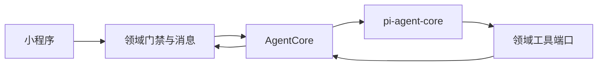

# AI Native Agent Core

日期：2026-10-23  
状态：架构规格。本文不实现云函数，也不选择模型供应商。  
分支：`dev-agent-core`（从 `dev` 迁出）  
取代：`docs/superpowers/specs/2026-09-09-survey-instrument-ai-native-mall-design.md` 中的 Agent harness，以及 `docs/superpowers/specs/2026-09-13-unified-search-context-hub-design.md` 第 3 节冻结的问答接口。

## 1. 结论

`@earendil-works/pi-agent-core` 只负责一轮里的模型循环、工具调用和取消。仓库里的 Agent Core 包在它外面，提供统一回合契约、profile、身份、上下文投影、工具权限和可观测事件。

业务真相留在领域服务。客服线程、工单状态和用户可见消息继续由 `cloudfunctions/ticketing/` 持有。播放页问答使用独立的视频作用域会话。Core 不接管转人工、订单或通知。

第一期用两个 C 端 profile 验证这套内核：播放页 `video_doc@v1`，客服 `customer_service@v1`。以后的搜索助理或运营助手只增加 profile 和领域端口，不另写生成循环。

不接入 `pi-coding-agent`，不向模型提供数据库句柄、任意云函数 action、任意 HTTP、文件系统或 shell。

## 2. 范围

第一期要证明：

- 播放页和客服都走同一个 `runTurn`。
- 两个场景的会话不合并。播放页只回答当前已发布视频及其关联上架商品。
- 客服只在领域状态允许时进入模型。转人工之后只追加用户消息。
- 主体从第一期就区分 `end_user` 与 `operator`。第一期不启用运营 profile，也不允许运营身份调用 C 端 profile。
- 一次回合的排障可以在云开发日志里按 `requestId` 检索，不自建指标库。

第一期不做：

- 跨场景自动跳转，或把播放页历史并入客服线程。
- 运营助手、搜索框闲聊、下单、退款、改订单。
- 抽帧、按播放进度切章节、向量库、知识库全文注入。
- 把日志投递到腾讯云 CLS，或接入腾讯云 APM 探针。
- 在小程序里运行 Agent 循环，或让客户端上传 prompt、工具列表、openid、权限。

若以后做跨场景引用，只能由用户显式生成一份最小化引用包（视频 id，以及用户选中的消息 id）。客服读取这份引用并写入自己的线程。两个会话仍然分开。

## 3. 分层与调用方向

小程序只提交场景坐标和本轮文本。领域服务先确认身份、scope 和状态，再调用 Core。Core 按 profile 投影上下文并执行。工具结果必须来自领域端口。领域服务把用户可见回复写入自己的消息表。

播放页的领域 action 放在日后新建的云函数 `agent` 中。该云函数现在不存在，本文不创建它。客服 action 留在 `ticketing`。`ticketing` 在门禁通过后把回合交给 `agent` 里的 Core，不复制一套循环。

`customer_service` 拒绝小程序直调。请求体里的「已通过门禁」标志无效。调用来源以云函数上下文判定。`video_doc` 可以由小程序调用 `agent`，但 openid 只取 `cloud.getWXContext().OPENID`，视频是否已发布由服务端查询。

## 4. 回合契约

领域服务调用 Core 时使用下面的结构。客户端不能提交 `scope`、`actor` 或 `profileVersion`。

| 字段 | 来源 | 含义 |
| --- | --- | --- |
| `profileId` | 领域 action 固定填入 | `video_doc` 或 `customer_service` |
| `scope` | 领域服务生成 | 已校验的场景作用域，不是全局会话 |
| `actor` | 服务端身份 | `end_user` 或 `operator`，含主体 id 与授权范围 |
| `input.text` | 用户 | trim 后非空，最长 500 字 |
| `input.currentTimeSec` | 播放页可选 | 非负整数秒。只进入本轮投影文案 |
| `requestId` | 客户端本次发送 | 重试必须复用。换一次发送就换一个 id |

`requestId` 由客户端生成，领域服务原样传入。空值、超 64 字或含空白字符时拒绝，不调用模型。

Core 返回：

| 字段 | 含义 |
| --- | --- |
| `ok` | 本轮是否产生可展示结果 |
| `code` | 失败时的稳定错误码 |
| `message` | 给用户看的短文案 |
| `text` | 助手正文。成功时非空 |
| `cards` | 渲染器放行后的卡片 |
| `messageId` | 领域消息表中的助手消息 id |
| `agentRunId` | 控制记录 id |
| `status` | `succeeded`、`failed` 或 `replayed` |

卡片只有三种：`video`、`shop_product`、`order`。每张卡片含 `type` 与 `id`。id 必须出现在本轮工具结果里。模型写出的链接、未知类型和未见过的 id 由渲染器丢弃。

内部事件不返回给小程序。流式输出第一期关闭；整轮完成后一次返回。

## 5. 主体、scope 与 profile

`actor.type` 只允许 `end_user` 与 `operator`。第一期两个 profile 都要求 `end_user`。`operator` 调用它们时返回 `FORBIDDEN`。运营 profile 以后单独注册，不能靠复用客服 profile 提权。

scope 由领域服务生成，Core 不信任客户端拼接的会话键。

| profile | scope | 隔离 |
| --- | --- | --- |
| `video_doc@v1` | 当前用户 + 已发布 `videoId` | 与其他视频、客服线程互不可见 |
| `customer_service@v1` | 当前用户的一条未关闭客服线程 | 不读取播放页消息表 |

profile 是带版本的服务端模块，不是运营可编辑的 prompt 文档。一个 profile 包含五部分：

- `scopeResolver`：核对场景对象并生成 scope。
- `policy`：主体、输入长度、工具上限、超时、上下文预算、模型路由。模型名只来自云函数环境变量。
- `contextProvider`：每一轮重新投影该 profile 需要的材料。
- `toolset`：本 profile 显式注册的工具。
- `renderer`：把模型输出收成正文和白名单卡片。

更换 prompt、工具或权限时递增 profile 版本。运行记录保存实际执行的版本。

### 5.1 `video_doc@v1`

入口是播放页对话区。服务端加载 `videoId`，只有 `status=published` 才继续。草稿、下架和不存在都返回 `NOT_FOUND`，不调用模型，也不把不可见文案写入投影。

投影只包含当前视频的标题、简介、标签、品牌、型号，以及该视频关联的上架商品。已有转写字段可以进入投影。`currentTimeSec` 写成「约第 N 秒」，不触发 seek，也不注册抽帧工具。

工具只有当前视频文档和关联上架商品的只读查询。没有全库 `search`、订单、转人工和任何写入工具。问到其他视频或其他型号时，回答请回讲解搜索或打开对应播放页。不注入那一条视频的正文，也不改 profile。

未登录用户使用微信上下文给出的 OPENID。播放页提问不要求先登录。下单仍走商城。

### 5.2 `customer_service@v1`

入口是客服 tab。scope 是 `ticketing` 已经确认归属的未关闭线程。

投影不塞入某条视频的全部转写。可以包含本轮工具返回的检索摘要和本人订单摘要。

工具：

| 工具 | 类型 | 约束 |
| --- | --- | --- |
| `search` | 只读 | 调用统一 `search`。入参和出参使用搜索规格第 2.1 节。不直连 `search_chunks` |
| `own_orders` | 只读 | 用户 id 只取 `actor`。忽略模型传入的 openid。只返回待付款、已付款、已关闭 |
| `escalate` | 交接 | 请求领域状态机转人工。不直接改线程文档 |

没有下单、支付、退款和通知工具。没有依据时说明不知道，并提示转人工或去讲解、商城搜索。能引用就出卡片。不编造物流或发货时间。

搜索规格当前只实现 `scene=video`。在商城检索落地前，`search` 工具只发送该规格已经接受的 `scene=video`。Core 不另写一套商品检索。

## 6. 工具治理

工具按能力注册，分只读查询、需确认的业务动作、交接动作。第一期没有需确认的业务动作。

每次执行前 Core 再查四件事：工具属于该 profile 版本、参数符合 schema、`actor` 具有该能力、资源属于当前 scope。领域端口做最后一次归属校验。模型不能提交 openid、员工 id 或「跳过鉴权」。

单轮最多 5 次工具调用。单个工具超时 5 秒。一轮模型与工具的总预算 20 秒，并且必须留在云函数超时之内。超限时停止继续调用，写入失败状态，返回 `TIMEOUT`。已成功的用户消息保留。

## 7. 持久化与恢复

用户看见的消息只有一份，写在领域消息表。

| 场景 | 真相 | 助手消息标记 |
| --- | --- | --- |
| 客服 | 现有 `cs_threads`、`cs_messages` | `meta.source=agent`、`profileVersion`、`agentRunId`、卡片摘要 |
| 播放页 | 日后的 `video_doc_threads`、`video_doc_messages` | 同上 |

播放页集合按用户与 `videoId` 隔离，仅云函数可读写。本文不修改 `ensureCollections`。

`agent_runs` 只保存恢复和幂等所需的控制状态：`requestId`、`agentRunId`、`profileId`、`profileVersion`、`scopeHash`、`actorType`、状态、错误码、创建和更新时间。不保存提示词、消息正文、工具原文、openid 或订单内容。它不用于检索排障，也不用于告警。

同一 scope 同时只有一个 `running`。处理顺序：

1. 领域服务校验身份、scope、状态和 `requestId`。
2. 内容安全在领域服务完成，沿用现网 `msgSecCheck`。本地可以 `SKIP_CONTENT_CHECK=1`，正式环境不可以。未通过则不写用户消息、不调用 Core。
3. 幂等键是 `scopeHash + requestId`，不是全局 `requestId`。同一 scope 内该键已成功：返回原来的助手消息，状态 `replayed`，不再调用模型，也不再执行交接工具。
4. 同一幂等键仍在预算内运行：返回 `IN_PROGRESS`。
5. 同一 scope 已有另一个运行中的幂等键：返回 `IN_PROGRESS`，不排队。
6. 通过后先写用户消息，再把 `agent_runs` 置为 `running`。
7. Core 成功后，领域服务写入助手消息，并把控制记录置为 `succeeded`。失败时保留用户消息，控制记录置为 `failed`，不编造助手正文。
8. 运行超过总预算仍为 `running`：标为 `failed`。同一个幂等键可以再恢复一次，不新写用户消息。第二次仍失败则停止自动恢复。

交接工具成功后，领域状态机进入人工状态。重放该幂等键不得再次转人工。

## 8. 客服状态门禁

状态机以 `cloudfunctions/ticketing/lib/csThreadState.js` 为准。状态是 `open`、`waiting_human`、`human`、`closed`。不新增 `ai` 状态，也不把 `open` 改名作为接入前置。

`canRunAgent(status)` 与现有 `canAutoRuleReply(status)` 使用同一条件：只有 `open` 为真。`waiting_human`、`human`、`closed` 只追加用户消息，不调用 Core。

`ticketing` 在调用 Core 之前完成本条消息的分流。`canRunAgent` 为假时只能写用户消息并维持人工状态。状态为 `open` 时：

| 输入 | 去向 |
| --- | --- |
| `csEscalate`，或 faqId 为 `human`、`missing`、`claim` | 现有状态机，不进入 Core |
| faqId 为 `howto`，以及其他自由输入 | `customer_service@v1` |

领取账号、转人工和「没有我要的讲解」都不注册成模型工具。Core 不发送工单通知，也不处理会话认领。

## 9. 错误

领域服务把 Core 的错误码映射成现有风格的 `{ ok:false, code, message }`。门禁拒绝、内容安全拒绝和幂等重放使用正常返回，不抛出未捕获异常，避免云函数错误次数把它们算成模型故障。

| 码 | 何时 | 是否调用模型 |
| --- | --- | --- |
| `BAD_INPUT` | 文本、`requestId`、profile 或播放位置不合法 | 否 |
| `NOT_FOUND` | 视频不可见，或客服线程不存在 | 否 |
| `FORBIDDEN` | 线程不属于当前用户，或主体与 profile 不匹配 | 否 |
| `CONTENT_REJECTED` | 内容安全未通过 | 否 |
| `INVALID_STATE` | 当前状态不允许 Agent 或交接 | 否 |
| `IN_PROGRESS` | 同一回合或同一 scope 已在运行 | 否 |
| `DOMAIN_UNAVAILABLE` | 视频、线程、搜索或订单端口失败 | 已开始则停止 |
| `MODEL_UNAVAILABLE` | 模型密钥缺失、配置错误或供应商失败 | 已尝试 |
| `TIMEOUT` | 工具次数、单工具或总预算超限 | 已开始则停止 |
| `RATE_LIMITED` | 超过该主体、profile、scope 的频率上限 | 否 |

频率上限的具体数字放在 profile policy 常量里，不由客户端传入。第一期每个用户、每个 profile、每个 scope 每分钟最多 6 次新回合。重放不计数。

用户文案只说明能否重试或需要转人工，不包含供应商错误、堆栈和内部 id。

## 10. 可观测性

可观测性使用微信云开发日志监控和腾讯云可观测平台。不自建指标集合，不把 APM 探针作为云函数接入方式。

每一轮用 `wx-server-sdk` 的 `cloud.logger()` 写结构化事件。`logger()` 在云函数入口内调用。固定事件为 `gate`、`context`、`model`、`tool`、`persist`。字段只包括：

- `event`、`status`、`durationMs`、`errorClass`
- `requestId`、`agentRunId`、`profileId`、`profileVersion`
- 模型事件额外有 `model`、`tokenInput`、`tokenOutput`
- 工具事件额外有 `toolName`、`resultCode`
- `enteredModel`：未进入模型的终止事件为 `false`

云开发服务调用日志已有 `traceId` 与 `spanId`，用于关联同一次请求中的云函数、数据库和存储。Agent 事件使用云函数 `requestId`，不另造链路 id。

调用次数、运行时间、错误次数、超时和限流使用云函数自带监控。告警在腾讯云可观测平台配置，策略类型选择「云开发」。这些指标看不到 profile、工具失败和 token；业务维度只存在结构化日志里。

完整提示词、消息正文、工具参数、工具结果原文、openid、文件 id 和密钥不写日志。日志写入失败不回滚已经成功的用户回复。

第一期交付日志检索和云函数基础设施告警。按 profile 做仪表盘、长期保留或业务字段告警时，再把云开发日志投递到腾讯云 CLS。绑定后由 CLS 单独计费且不能切回，因此不是第一期前置。

## 11. 测试

测试分三层，核心自动化不依赖真实模型：

- Core：非法 profile、主体不匹配、工具不在白名单、伪造 openid、卡片 id 不是本轮工具结果、超限停止。
- 领域适配：已发布视频才可提问；客服 `open` 才能运行；`waiting_human`、`human`、`closed` 不调用 Core；`claim`、`human`、`missing` 和显式转人工不进入模型。
- 替身模型：同一幂等键不重复写助手消息、不重复转人工；超时保留用户消息并返回 `TIMEOUT`；内容安全拒绝不写库。

真实模型只做受控 smoke test，不作为这三层的通过条件。

## 12. 与搜索规格的关系

搜索框继续只调用 `search`，不进入 Agent Core。`search` 不运行 `pi-agent-core`。

客服找片时通过 `search` 工具回到同一套搜索入参和出参。播放页 profile 不获得全库搜索。知识库片段、嵌入供应商和 `scene=product` 仍由搜索规格决定；在那些能力落地前，Core 不直连底表来补齐。

## 13. 实现顺序

本文通过审阅后再拆实现计划。顺序是：Core 契约与替身执行器、播放页 `video_doc@v1`、客服 `customer_service@v1` 接入 `ticketing`。不要在一份计划里同时改检索、支付和工单状态机。
