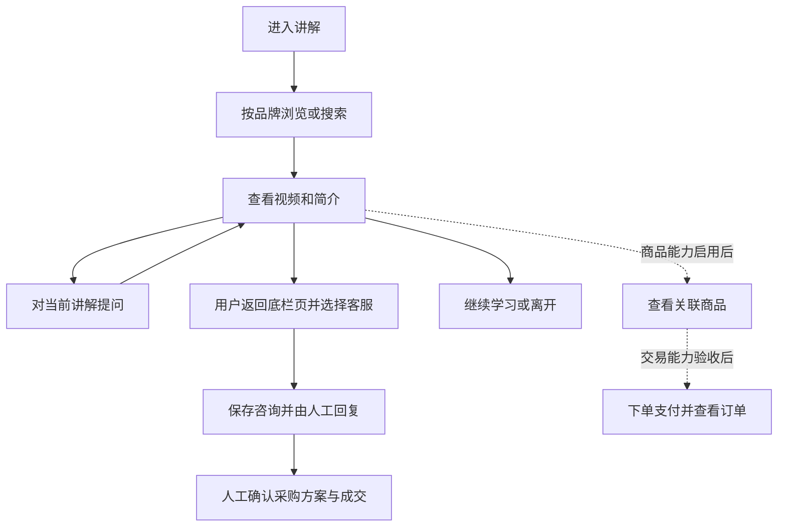

# 仪器讲解资料馆产品需求初稿

- 文档版本：0.1
- 日期：2026-11-04
- 状态：产品讨论稿，用户与场景假设待验证
- 载体：微信小程序及现有小程序运营工作台
- 运营主体：优度（杭州）智能装备有限公司

仪器讲解资料馆通过仪器演示、使用教学和基于资料的 AI 答疑，帮助有测绘仪器购买需求的客户理解产品、判断是否适合自己的工作，并进一步咨询客服或购买。本稿将这一路径作为产品主线，近期优先验证「找到讲解、理解内容、提出疑问、发起有效咨询」，保留平台内交易的后续需求。

本文档补充产品定位、用户假设、阶段范围、功能要求和衡量方法。文档版本与小程序发行版本分别管理；写成 PRD 不代表其中功能已经开发、发布或获得业务验收。

## 一 背景与目标

### 已明确的信息

| 信息 | 当前依据 |
| --- | --- |
| 最终目标客户是准备购买测绘仪器的客户 | 本轮产品讨论中已明确 |
| 视频小程序承担吸引潜在客户的作用 | 本轮产品讨论中已明确 |
| 用户通过视频学习使用仪器，并进一步在平台购买或咨询客服购买 | 本轮产品讨论中已明确的目标路径 |
| 当前项目由开发者主导实现，对具体业务尚不熟悉 | 用户与场景不能按已有业务调研结论处理 |
| 产品已有品牌、视频、搜索、问答、商品与客服等相关代码和规格 | 以文末列出的仓库资料为依据；各模块状态见第二节 |

### 商业目标

1. 通过相关讲解内容吸引对仪器有兴趣或购买需求的人。
2. 帮助潜在客户理解设备，减少购买前的信息疑问。
3. 让愿意进一步了解的人能够发起咨询，由客服确认用途、配置、报价和服务。
4. 在交易条件具备后，支持平台内购买，并分别记录平台成交和客服承接的成交。

视频是否能够持续带来目标客户、解答疑问是否能够增加咨询与成交，属于需要观察的产品假设。当前不预设用户规模、转化率、获客成本和销售增长幅度。

### 用户价值假设

用户可以通过与品牌、型号和操作主题对应的讲解资料，了解设备用途和使用过程；遇到资料能够回答的问题时获得解释，涉及具体采购条件时找到人工进一步确认。

本稿暂定的核心问题是：潜在买家仅凭设备名称或参数，可能难以判断实际使用方式及是否适用，需要演示、解释和进一步咨询来辅助选择。

## 二 现有基础与文档关系

### 当前基础

下表依据当前工作区的说明、规格和代码静态核对。实际体验版、云端与真机状态需按发布记录和对应验收确认。

| 模块 | 当前可确认的基础 | 本稿如何使用 |
| --- | --- | --- |
| 讲解目录与关键词搜索 | README 描述品牌、视频目录、关键词搜索和运营入库 | 作为内容发现的已有基础 |
| 播放页 | 现有页面包含播放器，以及「简介」「问答」两个内容页签；简介可显示关联商品 | 沿用页面结构，补充产品要求与验收 |
| 播放页问答 | 当前功能分支有视频范围问答实现；TokenHub 统一计划记录本地验收完成，云端与真机待验收 | 列入近期验证范围，实际可用性仍需真实模型与设备检查 |
| 人工客服 | 当前入口调用 ticketing，具备会话、转人工、运营回复和关闭相关能力 | 作为购买咨询承接的基础 |
| 客服 AI | 模型配置已经预留，现有接入说明明确自动回复尚未接入 | 后续独立需求，不当作当前默认客服能力 |
| 商品浏览与关联 | shop 有上架商品查询、编辑及视频关联接口；商城页已登记 | 可复用基础，当前底栏仍为「讲解、客服、我的」 |
| 支付与订单 | 既有总规格描述购物车、支付和订单；当前 shop 分发入口未包含这些交易动作 | 作为后续交易需求，不按已交付功能描述 |
| 运营与人员 | 已有内容、商品、工单、人员及模型相关页面和说明 | 沿用现有角色与权限，不另建后台 |
| 产品指标 | 本稿提出业务指标与事件需求 | 不默认已经采集，也不以 Agent Trace 代替业务统计 |

### 与已有规格的关系

- 原商城与 AI 总规格继续提供商品、订单和整体购买路径的详细约束。
- 搜索的阶段范围、播放页与客服的 Agent 边界，采用较新的搜索规格和 Agent Core 规格。
- 运营人员身份采用人员名单规格，日常操作不沿用旧总规格中的共用口令票据模式。
- 本稿提出近期产品验证顺序，不改变既有接口、客服状态机、发布分支规则，也不合并独立功能分支。
- 后续如调整播放页客服入口、跨场景信息传递、交易规则或 AI 权限，应同步修改对应规格后实施。

## 三 目标用户与使用场景

### 目标用户

主要用户暂按行为定义为：有测绘仪器选购需求，主动查看使用演示，并参与设备选择的人。

参考画像是既参与选型、又需要实际使用设备的一线人员或小团队负责人。其职业构成、所在地区、预算、采购周期和重点仪器品类均待补充，不把此画像当作已调研事实。

| 用户或角色 | 主要任务 | 产品关注点 |
| --- | --- | --- |
| 潜在买家，主要用户 | 了解设备、判断是否适用、确认购买条件 | 找到相关内容，获得可靠解释，进入咨询或购买 |
| 已有仪器的学习者，次级用户 | 学习操作或解决使用疑问 | 资料准确、型号清楚、问题能得到解释；其观看不自动计为购买意向 |
| 客服或销售人员 | 理解客户需求，确认配置、报价与服务，跟进销售 | 咨询可查看、可回复、可继续跟进 |
| 内容运营人员 | 整理讲解、核对资料、维护商品关联 | 入库和审核可操作，错误内容可修改或下架 |
| 管理员 | 维护运营人员与访问权限 | 可邀请和停用人员，保护管理功能 |

### 场景假设

| 场景 | 触发条件 | 用户任务 | 完成表现 |
| --- | --- | --- | --- |
| 初步了解设备 | 对某类仪器或某个品牌感兴趣 | 看懂设备主要用途和基本操作 | 找到相关讲解，能继续浏览或明确自己的问题 |
| 关注具体型号 | 已经有候选设备，但操作或配置信息不清楚 | 查看对应型号与功能演示 | 对照资料理解用途与限制，知道哪些信息仍需确认 |
| 看完后仍有疑问 | 视频或简介中某一步没有看懂 | 围绕当前讲解提问 | 得到有依据的解释，或知道资料不足及下一步去向 |
| 准备进一步购买 | 需要确认配置、报价、供货或服务 | 向客服说明需求 | 咨询成功保存，运营能够查看并回复 |
| 已购后学习 | 已有设备，遇到操作问题 | 查找特定主题并学习 | 完成学习任务，或提出新的资料需求 |

首次购买、换机和新增设备可能对应不同需求。当前先围绕「买前了解与咨询」设计；后续通过咨询类别、使用记录及可获得的销售反馈细分。

### 进入方式

候选分发方式包括商家发送的小程序链接或码，以及用户之间的分享。这些方式属于待验证的获客假设；本稿不承诺自然流量，也不预设投放渠道和投放预算。来源不明确的访问记录为「来源未知」。

## 四 产品路径与信息架构

### 核心路径

潜在买家进入讲解，按品牌、型号或操作主题找内容，在播放页查看视频与简介，必要时对当前资料提问，再由用户选择继续学习、咨询客服或查看已启用的商品信息。

近期咨询路径沿用现有导航：用户从播放页返回底栏页面，再选择「客服」。播放页问答不自动跳转客服、不执行转人工，也不自动把问答历史复制到客服。是否增加用户主动选择的咨询快捷入口，列为后续交互决策。

这张图表达产品目标路径，实线与虚线均不作为当前发布状态的证明。学习者完成学习后离开，也属于正常使用结果。

### 信息架构

| 入口或页面 | 职责 | 阶段 |
| --- | --- | --- |
| 讲解 | 品牌与视频浏览、关键词搜索 | 当前底栏入口，近期继续使用 |
| 播放页 | 视频播放、简介、当前讲解问答，按已启用数据展示关联商品 | 保留现有「简介、问答」页签 |
| 客服 | 快捷问题、人工咨询及消息历史 | 近期以既有规则与人工客服为准 |
| 我的 | 用户信息、版本等既有内容；仅启用人员可见运营工作台 | 订单能力随交易阶段启用 |
| 商城与商品详情 | 上架商品信息、规格与关联讲解 | 单独验收后开放；不因页面已登记而视为已开放商城底栏 |
| 运营工作台 | 内容、商品、工单、人员及模型管理 | 沿用现有工作台和身份规则 |

## 五 阶段范围与优先级

这里的优先级表示产品草案的验证顺序，不表示所有能力都要重新开发，也不构成一次发行全部上线的要求。

| 阶段 | 范围 | 验证目的 | 进入下一阶段的条件 |
| --- | --- | --- | --- |
| A 讲解与咨询验证，近期重点 | 内容浏览、关键词搜索、播放与简介、当前视频问答、人工客服、最小指标记录 | 相关内容是否能帮助理解，并产生有效咨询 | 真机关键路径可用，AI 边界检查通过，有可分析的试用与咨询记录 |
| B 商品与内容关联 | 上架商品浏览、商品详情、视频与商品互相引用 | 客户是否需要从内容进入具体商品，商品信息能否支持进一步决策 | 商品信息与维护责任明确，关联与上下架验收通过 |
| C 平台内交易 | 购物车、结算、微信支付、本人订单、线外履约所需信息 | 是否能在平台完成购买并供运营承接 | 支付配置、真实回调、订单与履约流程均完成独立验收 |
| D 客服 AI | 在既有客服状态门禁下接入自动答疑、可用检索和已就绪的本人订单查询 | 是否能够准确处理常见问题并正确交接人工 | 领域数据端口就绪，客服评测与人工接管验收通过 |

阶段 D 可独立于交易推进；订单查询仅在订单服务就绪后启用。阶段 A 不依赖先完成商城、支付、向量检索或客服 AI。

## 六 功能需求

### 讲解发现与关键词搜索

用户能够按品牌浏览讲解，使用关键词查找标题、型号、标签或简介相关内容。结果提供能识别内容的标题、封面和必要的品牌、型号信息。

- 只展示已上架视频。草稿、下架和不存在的内容不得通过前台列表、搜索、直接链接或面向用户的 AI 问答被读取。
- 搜索提交后展示加载状态，避免重复提交；失败保留输入并允许重试。
- 空输入提示输入关键词；有词零命中提示换词或按品牌浏览；服务异常显示错误，三者分别处理。
- 关键词搜索沿用当前可用基础。独立 search 的迁移按已有搜索规格验收；语义搜索、商品搜索和全库混排不作为阶段 A 的必要条件。
- 有共享 Embedding 接口不代表语义检索已接入；不在界面承诺尚未验收的搜索能力。

### 视频播放与资料展示

用户进入视频后能够播放，并查看标题、品牌、已维护的型号、标签和简介。简介说明本片实际讲解的用途或操作，缺失信息不得由模型或页面补成确定事实。

- 保留现有播放器和「简介、问答」页签结构，不因本稿新增整体页面改版。
- 视频播放失败展示可理解的错误及重试方式；资料加载失败与媒体播放失败应可区分。
- 型号未维护时不猜测型号，也不展示虚构的适用范围。
- 关联商品仅展示已上架且关联有效的记录；无关联商品时不展示占位购买项。
- 返回和切换页签时不自动发起咨询、生成订单或改变客服状态。

### 当前视频 AI 问答

问答帮助用户理解当前讲解，回答依据仅限当前可见视频资料与已授权的关联商品信息。

输入规则：正文去除首尾空白后为 1 至 500 字；发送时显示处理中并防止重复提交；失败保留可重试的信息，同一次发送的重试不得新增重复消息。

| 问题类型 | 预期行为 |
| --- | --- |
| 当前资料已有明确答案 | 按资料解释，保留必要条件与操作顺序 |
| 当前资料缺少答案 | 说明缺少依据，提示可进一步咨询，不补充猜测的参数或结论 |
| 指代不清或问题含糊 | 在现有上下文足以确定时回答，否则请求必要澄清 |
| 询问其他视频、型号或全站内容 | 说明当前范围，提示回到讲解搜索或打开对应资料 |
| 询问报价、供货、服务承诺 | 只说明资料中明确存在的信息；需实时或个性化确认的部分交由客服 |
| 要求下单、支付、退款或修改订单 | 不执行业务动作，说明对应操作入口 |

会话按用户和当前视频隔离，重新进入能够读取本人该视频的历史。不同视频和客服线程的正文不自动互通；同一用户身份不意味着所有历史都可被模型读取。

播放时间只能作为用户提问的辅助信息，不代表模型理解了该时刻的画面。阶段 A 不做抽帧、自动跳转章节或自动定位播放。

模型调用沿用现有受限回合：模型与工具共享 20 秒预算，单轮最多 5 次工具调用。该预算不是小程序端到端响应承诺。超限或模型不可用时给出失败与重试提示，视频播放和客服入口仍可使用。

### 人工咨询与客服

用户通过现有客服入口发送购买或使用问题，咨询成功以服务端消息保存成功为准。仅打开客服页、点击按钮或阅读快捷回复不算已经形成有效销售线索。

- 快捷规则与人工对话沿用现有客服体系；本阶段不把自由输入默认交给尚未接入的客服 AI。
- 用户能够查看本人历史、发送消息、请求人工；运营能够在工作台查看、回复和关闭工单。
- 保留 open、waiting_human、human、closed 状态及其既有转移规则。进入等待人工或人工处理中后，模型不得继续自动回复。
- 关闭的旧线程只读；用户再次发送时进入新线程，旧历史不得被覆盖。
- 新工单和已回复通知按现有授权与模板配置处理；通知失败不能回滚已保存的工单或回复。
- 不承诺未实现的实时推送，也不在未明确人员排班前承诺固定回复时限。
- 播放页问答与客服各自保存历史。后续如需要携带视频标识或选中的消息，另行设计用户主动选择与最小信息传递。

### 内容运营与人员管理

运营可以维护品牌、视频、简介、标签和商品关联，审核后上架；错误资料能够修改或下架。

- 沿用现有上架条件：标题、简介、封面、视频等必需信息齐全；型号和标签按现有规则维护，不凭空补全。
- 视频与简介须核对品牌、操作内容及型号适用范围。转写和 AI 简介均可能出错，自动生成的简介保持待人工核对，不自动上架。
- 人工编辑的简介不得被后台重新处理无条件覆盖。
- 管理员和运营沿用现有微信身份名单；普通用户不得访问管理功能，停用人员下一次管理请求应被拒绝。
- 管理员负责人员邀请、角色和启停；运营处理现有日常工作，不扩展为任意数据访问权限。
- 工作台允许按场景选择和测试模型。保存配置、配置就绪、固定短句连通、实际问答或简介验收分别记录，不能互相代替。

### 最小业务记录

阶段 A 需要能够区分观看、提问、人工咨询和有效咨询。优先复用可确认的现有记录，并按第八节补充必要事件。

在事件采集未完成时，可由有权限的人员使用简单登记表记录试用和咨询结果。登记至少包含日期、匿名线索编号、需求类别、来源是否可确认、是否有效咨询、跟进和成交状态；暂不增加完整销售管理系统。

未采集或不能关联的指标标为「未采集」或「来源未知」，不能写成零咨询或零成交。

### 商品展示与内容关联

阶段 B 复用现有商品目录与关联基础，并分别验收前台可见性和运营维护。

- 型号目录与可售商品分别管理；视频型号记录不能直接当作可以支付的商品。
- 商品展示名称、图片、已维护的价格、规格和说明；运营对准确性及更新负责。
- 视频与商品可多对多关联；两侧只引用已上架的对象。
- 商品下架后，不得出现在前台列表、关联位置或 AI 商品卡片中。
- 商品是否可售按本期约定的上下架规则判断；不承诺已具备库存数量校验。
- 商品页登记、商品浏览上线、商城底栏开放分别确认。底栏是否增加「商城」随该阶段验收决定。

### 平台内购买与订单

阶段 C 沿用原交易规格：商品详情、购物车、确认订单、支付、本人订单；具体交易行为需独立设计、实现和验收。

- 服务端按当前上架商品价格和数量计算金额，不使用客户端提供的总额作为支付依据。
- 下单前核对上架状态；结算时已下架应拒绝并说明。按原规格收集姓名、手机和收货地址，用于线外履约。
- 订单使用待付款、已付款、已关闭三种状态。支付取消保留待付款，可重新发起；已关闭订单不可继续支付。
- 已付款以服务端校验通过的支付结果为准，不能仅根据前端成功回调更新；重复回调不重复计款或重复计成交。
- 用户仅能访问本人订单；运营只在授权范围内查看履约所需信息。
- 本期不维护已发货、运输中、已签收状态和物流轨迹；退款由客服承接与人工处理，不虚构自动退款完成。
- 支付成功与关闭并发、超时关单、价格变化及失败恢复的规则，在交易设计中明确并通过测试后，才开放真实支付。

### 后续客服 AI

阶段 D 仅在既有客服状态允许时运行模型，通过领域服务查询可见讲解、已就绪的商品或本人订单，不直接读任意业务数据。

人工接管入口保持可用。转人工由客服状态机决定；模型不直接改线程、发送通知、下单、支付或退款。商品搜索和订单端口未就绪时，不向模型开放对应能力，也不以空结果伪装业务故障。

## 七 内容与 AI 质量要求

### 内容质量

讲解与简介保持内容一致，明确已知品牌和型号，保留影响操作的条件。缺少资料、资料冲突或不同版本差异时，应由运营核对后补充；不要求用户在资料未齐全时相信 AI 的推断。

首批内容优先覆盖现有素材中与买前理解相关的用途、操作过程和常见疑问。具体品类与主题按素材和可获得的咨询记录选择，不虚构用户最关心的主题排名。

### 问答评测

建议先为阶段 A 建立 40 个经核对的评测问题。下表数量与门槛属于初稿建议，均不是已测结果。

| 类别 | 建议数量 | 检查重点 |
| --- | --- | --- |
| 当前资料可回答 | 20 | 事实正确、必要条件齐全、表达能帮助理解 |
| 当前资料缺少答案 | 8 | 明确说明缺失，不捏造参数、操作或采购承诺 |
| 超出视频范围 | 6 | 不读取其他视频或用户信息，正确说明去向 |
| 含糊与多轮追问 | 6 | 利用当前上下文，必要时澄清，不擅自确定型号 |

每题保存输入、允许使用的资料、必须包含或禁止出现的事实及判定标准。专业事实由熟悉仪器的人复核；复核人员尚未落实时，该项保持待验收，模型自评不替代专业正确性核对。

建议初始门槛：20 道可回答题至少 18 道正确；缺失、越界与歧义题全部符合对应边界要求。整套题中不得出现严重误导的操作、未经证实的设备参数、采购承诺或他人数据。固定配置至少运行两轮，记录每轮结果及差异；即使总分达标，严重错误仍需修复后复验。

另外用受控检查覆盖下架、伪造身份、重复发送、模型超时、断网和通知失败。这些检查与真实模型问答分别记录。固定短句连通、离线替身测试和真机完整路径分别提供不同层面的证据。

### 可用性与信息保护

- 问答或模型服务故障不得影响内容浏览与人工咨询；失败时保留用户可继续操作的入口。
- 用户正文、工具结果和订单资料只在各自授权业务范围内使用。客户端不得选择模型权限、用户身份或读取其他用户的数据。
- 密钥与管理员口令留在服务端；面向用户的错误不包含密钥、堆栈、供应商错误正文或内部标识。
- Agent Trace 沿用现有脱敏规则，只记录状态、耗时、用量等排障信息，不上传提示词、用户正文、原始工具内容或 OpenID。
- 视频首帧、问答端到端耗时和客服首响分别记录。首轮试用建立基线，性能目标结合真实设备与网络条件设定。

## 八 指标与采集需求

### 业务口径

「人工咨询」指用户在客服提交、并由服务端保存的非纯快捷规则消息。「有效咨询」暂定为人工判断具有明确用途、型号、配置、报价或采购问题的咨询；普通问候、领取账号和纯教学问题不自动计为有效购买咨询。

近期主要观察新增有效咨询人数，同时关注用户是否获得解释、客服是否能够承接。平台购买开放后再增加已支付订单；客服承接的成交另行记录。

| 指标 | 暂定口径 | 使用边界 |
| --- | --- | --- |
| 讲解观看人数 | 统计期内确实触发播放开始的去重访客数 | 打开页面不等同已观看；排除可识别的测试和运营访问 |
| 观看后有效咨询率 | 同批观看者在首次观看后 7 日内新增有效咨询的去重人数，除以该批观看者人数 | 7 日为初稿建议；窗口结束后汇总，已有咨询不重复算新增 |
| 新增有效咨询人数 | 统计期首次形成有效购买咨询的去重线索人数 | 重复消息和重复联系不重复计数；人工分类口径需一致 |
| 有效咨询后成交情况 | 对有效咨询批次，记录其后 30 日内可确认成交的人数及成交方式 | 30 日为初稿建议；无法确认的单列为未知，不判为未成交 |
| 问答正确与边界合规情况 | 按第七节的固定问题集逐类统计 | 不用请求成功率代替答案质量 |
| 模型成本与耗时 | 按场景记录调用用量、失败情况及端到端耗时 | 缺少实际计价或用量时不推算精确成本 |

观看与后续咨询的时间关联只能说明可观察的路径，不能单独证明视频或 AI 造成了销售增长。试用结论同时列出样本人数、观察窗口和可关联记录的覆盖情况。

### 事件需求

下表是待实施或核对的采集需求。事件名称用于产品与开发对齐，不表示代码已经提供这些事件。

| 事件 | 触发时机 | 最小业务字段 |
| --- | --- | --- |
| 进入讲解 | 讲解入口成功打开 | 来源类别、入口页，未知来源明确记录 |
| 搜索完成 | 返回结果或明确失败 | 场景、结果数、结果状态；不默认上传原始搜索文本 |
| 视频播放开始 | 播放器确认开始播放 | 视频标识、进入来源 |
| 问答发送成功 | 服务端保存当前问题 | 视频标识、回合标识、场景 |
| 问答完成 | 成功返回或明确失败 | 状态、错误类别、耗时、模型配置版本及可用用量 |
| 人工咨询保存成功 | 客服消息服务端落库 | 匿名线索标识、线程标识、当前服务状态 |
| 有效咨询确认 | 人工按统一口径标记 | 匿名线索标识、需求类别、确认日期 |
| 成交确认 | 平台支付校验通过，或人工确认客服成交 | 成交方式、匿名线索标识、去重成交标识、确认日期 |

事件共有字段包括事件标识、时间、环境、应用版本和服务端生成的匿名关联标识。事件标识用于重试去重，时间统一存储并按北京时间展示；测试和生产分开统计。

业务归因记录与 Agent Trace 分开处理，不把 OpenID、手机号、地址、完整对话或订单正文加入指标事件。匿名关联记录仍按内部数据限制访问，保留周期在实际采集前明确。

近期按「此前观看过讲解」记录来源关联，不自动认定某条视频贡献了成交；来源无法可靠匹配时记录未知。采集来源不向客服或模型自动传递播放页问答正文。

## 九 验收要求

下列为待执行的验收清单，结果应记录对应环境、版本和证据。当前编写文档不将任何一项标记为通过。

| 范围 | 必须观察到的结果 | 验证方式 |
| --- | --- | --- |
| 讲解浏览 | 上架视频可见，草稿和下架内容在列表、搜索和直达时均不可读 | 固定数据检查加真机操作 |
| 搜索 | 正常返回、空词、零命中和故障分别展示；失败保留输入 | 页面检查与受控故障 |
| 播放与资料 | 真机可播，简介与元数据正确；失败可识别；保留现有页签结构 | 实际部署后的设备验收 |
| 视频问答 | 当前视频正常问答；历史按用户及视频隔离；重复发送不重复落库 | 真实模型样例与权限、重试检查 |
| 问答质量 | 固定题集达到约定门槛，无严重误导或越权输出 | 专业复核加多轮评测 |
| 咨询承接 | 返回客服后可发送，运营能看到并回复，用户再次进入可读 | 用户和运营两个身份操作 |
| 人工接管 | 等待人工、人工处理中无 AI 自动回复；关闭后旧线程只读 | 状态与消息检查 |
| 通知失败 | 未授权、未配置或发送失败时工单和回复仍保存成功 | 受控故障加页面检查 |
| 内容运营 | 自动简介保持待核对，人工稿不被覆盖；下架后各入口失效 | 实际任务与编辑、上下架操作 |
| 管理权限 | 普通或停用人员不能执行管理动作；运营不能改人员 | 多身份检查 |
| 指标记录 | 成功保存与按钮点击分开，重试不重复计数，未知来源不伪归因 | 事件或登记表逐条核对 |
| 商品阶段 | 双向关联只含上架对象，信息与规格一致 | 前台与运营端联合验收 |
| 交易阶段 | 服务端计价、真实支付校验、取消与重试、重复回调及本人订单隔离正确 | 独立交易回归与目标环境实测 |
| 客服 AI 阶段 | 仅允许状态调用模型，权限受限，失败和转人工都可继续服务 | 独立客服评测与集成验收 |

## 十 试用与迭代安排

先选择一组资料齐全、可人工核对的现有视频，覆盖第七节的问题类别。完成云端配置、真实模型调用与真机基本路径检查后，再开展受控试用；模型调用未就绪时，内容与人工客服可以先分别检查。

试用中记录用户是否找到相关讲解、能否理解资料、提出了什么类型的问题、是否进入咨询，以及中断在哪一步。使用匿名编号记录必要事实，不把整段个人对话复制进公开报告。

每轮输出一份简短记录：样本与环境、观察到的成功或失败、咨询类别、问题原因、准备调整的内容与功能。先区分资料缺失、内容组织、问答质量和入口交互，再决定下一轮投入。

样本少时报告具体案例与人数，不据此宣称稳定转化提升。暂时无法获得成交反馈时，先报告观看与咨询阶段结果，成交效果保持待观察。

## 十一 边界与待明确事项

### 当前不纳入近期范围

阶段 A 不包含全站自动选型、多型号自动比较、视频画面理解、AI 自动成交、支付与退款动作、完整销售管理系统、推荐流、直播、营销投放系统或独立 Web 后台。

后续交易沿用现有阶段边界：不做库存扣减、仓储物流、自动退款状态机、优惠券、评价与多商户。向量检索和新增技术框架的投入，以真实搜索问题及独立验收为依据。

### 关键假设与风险

| 假设或风险 | 需要观察的证据 | 可能影响的决策 |
| --- | --- | --- |
| 教学观看者与潜在买家存在足够重合 | 观看后咨询的类别、来源可确认的有效线索 | 目标用户、内容选题和推广方式 |
| 视频与资料可以支持买前理解 | 具体疑问、资料缺失类别、问答评测失败项 | 补内容、调整简介或增加必要资料 |
| 用户能够发现并使用客服 | 播放后返回与咨询行为、试用中的中断点 | 是否设计主动咨询快捷入口 |
| 商家能够承接咨询 | 首响、未处理咨询、跟进结果 | 人员安排、回复说明与服务范围 |
| 商品信息能持续维护 | 价格、配置和上下架核对情况 | 商城开放范围与更新机制 |
| 成交可以被可靠记录 | 可关联线索与成交比例、未知来源比例 | 指标解释及交易功能优先级 |

### 待明确的业务与产品决策

1. 首批主推仪器品类、品牌、型号及实际购买参与者。
2. 哪些现有素材最适合买前了解，谁复核专业事实与内容适用范围。
3. 获客渠道、分发方式和客户最初进入的页面。
4. 谁承接咨询、服务时间，以及报价、供货和售后信息由谁维护。
5. 有效咨询与成交由谁标记，如何核对重复线索和平台外成交。
6. 7 日观看后咨询窗口、30 日咨询后成交窗口是否符合实际采购周期。
7. 播放页是否增加用户主动选择的客服快捷入口；是否需要携带最小视频引用。未决前沿用现有导航和会话隔离。
8. 商品与支付何时开放，以及支付关闭并发、履约、退款沟通等交易细则。
9. 产品事件的采集位置、访问人员与保留周期，以及初轮试用后的性能、成本和转化目标。

这些待明确事项用于后续修订本稿，不要求在写作阶段猜出业务答案。涉及交易承诺、专业正确性和跨场景权限的未决项，应在对应能力开放前明确。

## 十二 参考资料与版本记录

- [项目说明](../../../README.md)：产品名称、现有入口、待发版本说明与基础能力。
- [商城与 AI 产品需求](2026-09-09-survey-instrument-ai-native-mall-design.md)：整体商品、交易和后续客服需求。
- [既有需求总表](2026-09-09-survey-instrument-ai-native-mall-req-board.md)：原需求拆分；表内历史状态不作为当前交付证明。
- [统一搜索规格](2026-09-13-unified-search-context-hub-design.md)：讲解关键词搜索阶段与后续能力边界。
- [Agent Core 规格](2026-10-23-ai-native-agent-core-design.md)：视频和客服作用域、权限、状态门禁及观测规则。
- [运营人员名单](2026-10-22-admin-staff-design.md)与[运营使用说明](../../admin-staff.md)：现有角色、入口与管理方式。
- [模型接入说明](../../ai-model-setup.md)与[TokenHub 统一计划](../plans/2026-11-03-tokenhub-unification.md)：模型配置及本地、云端、真机的验收边界。
- [当前底栏配置](../../../miniprogram/app.json)、[播放页](../../../miniprogram/pages/player/player.wxml)、[商品服务入口](../../../cloudfunctions/shop/index.js)、[客服服务入口](../../../cloudfunctions/ticketing/index.js)：当前工作区结构与入口静态依据。

| 日期 | 文档版本 | 变化 |
| --- | --- | --- |
| 2026-11-04 | 0.1 | 根据已明确的销售获客目标形成完整初稿，补充用户与场景假设、阶段范围、功能要求、AI 评测、业务指标和待决策事项 |
